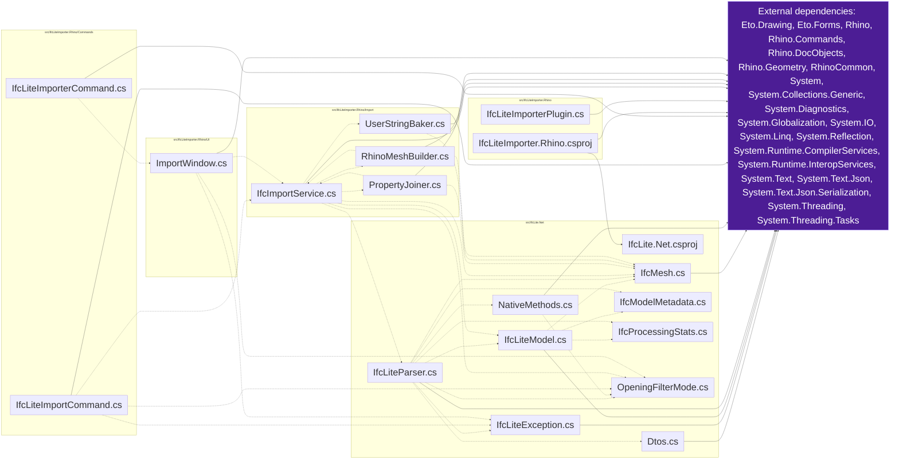

# CodeGraph

Generated by `tools/Update-CodeGraph.ps1`. Do not edit manually.

Solid arrows: resolved references/imports. Dashed arrows: inferred C# type usage.

19 source files scanned; 32 relationships found.

C# relationships are heuristic, not compiler-resolved. Python and JS/TS extraction covers common local import forms; HTML and CSS extraction covers local resource references.
